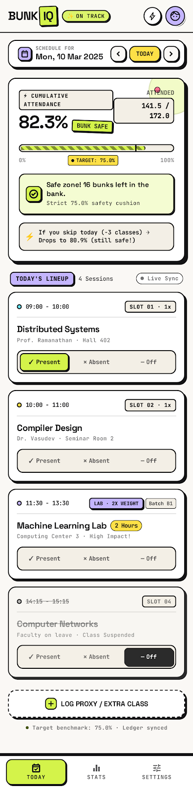

# 📚 BunkIQ — Smart Attendance Planner & Bunk Calculator

> Real-time college class tracker, smart safe-margin bunk calculator, and daily schedule manager for university students.

<p align="center">
  
</p>

<p align="center">
  <a href="https://bunkiq.vercel.app"></a>
  <a href="#"></a>
  <a href="#"></a>
  <a href="#"></a>
  <a href="https://opensource.org/licenses/MIT"></a>
</p>

---

## ⚡ Why BunkIQ?

College life is fast-paced, and maintaining the mandatory **75% minimum attendance requirement** can be stressful. BunkIQ calculates the exact mathematics of your academic schedule so you never fall below eligibility criteria.

### 🌟 Key Features
- **Smart Bunk Predictor**: Instantly know how many consecutive or selective lectures you can miss while keeping your percentage strictly above $75\%$.
- **Recovery Calculator**: If your attendance drops below the threshold, BunkIQ calculates the exact number of consecutive classes you must attend to restore eligibility.
- **Visual Subject Cards**: Color-coded progress pills, current attendance percentages, and warning badges.
- **Cross-Platform Synchronization**:
  - **`web/`**: Fast, lightweight responsive web client deployed on [bunkiq.vercel.app](https://bunkiq.vercel.app).
  - **`android/`**: Native modern Android Kotlin application using Jetpack Compose, Coroutines, and Firebase Cloud Firestore for real-time synchronization.

---

## 📸 Interface Preview

<p align="center">
  
</p>

---

## 🛠️ Project Structure

```
bunkiq/
├── docs/images/           # UI screenshots and visual assets
├── web/                   # Vercel responsive web application
│   ├── code.html          # Interactive timetable & bunk calculation engine
│   └── DESIGN.md          # UI design principles & typography spec
└── android/               # Native Android Kotlin application
    ├── app/               # Application module (Compose UI, ViewModels, Repositories)
    ├── firebase.json      # Cloud Firestore rules & config
    └── build.gradle.kts   # Kotlin Gradle DSL build configuration
```

---

## 🚀 Quickstart

### Web Client
Open `web/code.html` directly in any modern browser, or visit the live deployment at [bunkiq.vercel.app](https://bunkiq.vercel.app).

### Android Studio Setup
1. Open Android Studio and select **Open existing project**.
2. Select the `android/` directory.
3. Sync Gradle and build on your target device/emulator:
```bash
./gradlew assembleDebug
```

---

## 📄 License
MIT © [Atharva Jadhav](https://github.com/atharvabalujadhav21052007-ux)
